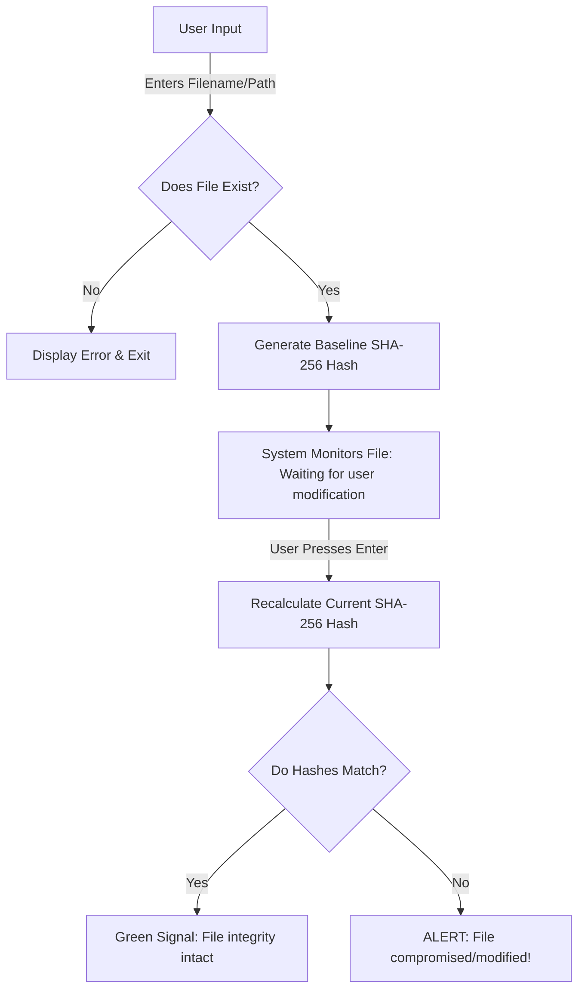

# deva.cyber.py

Repository dedicated to Cybersecurity research, Digital Forensics, and Ethical Hacking tools. Features practical scripts including cryptographic file integrity checkers, secure automation workflows, and defensive logic implementations built with Python.

## 📊 File Integrity Checker: System Architecture

## 📝 Component Responsibilities
This Python-based File Integrity Checker monitors a target file for unauthorized modifications by using SHA-256 cryptographic hashing. The application generates an initial baseline hash, waits for potential file changes, recalculates the file hash, and compares both values to verify integrity.

- **User Input:** Accepts the target file path from the user to initiate the monitoring process.
- **File Existence Validation:** Verifies if the file is available, preventing unnecessary hash calculations on invalid paths.
- **Baseline Hash Generator:** Computes the initial SHA-256 hash to establish a trusted reference.
- **Modification Waiting Phase:** Pauses execution, giving the user time to modify and save the file.
- **Integrity Verification Logic:** Recalculates the hash, compares both values, and triggers a security alert upon detection of a mismatch.
